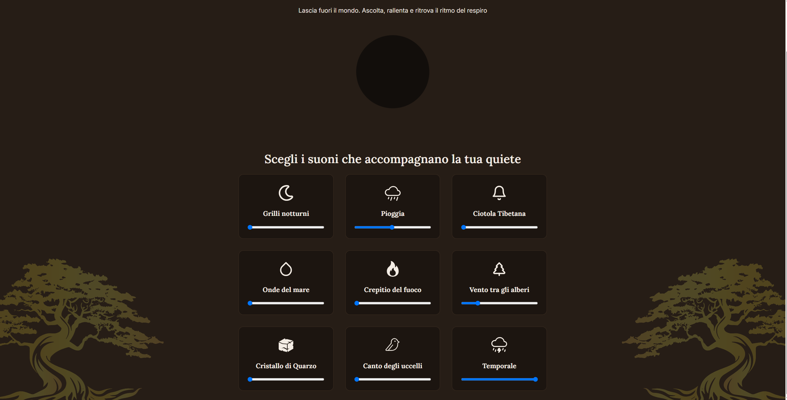
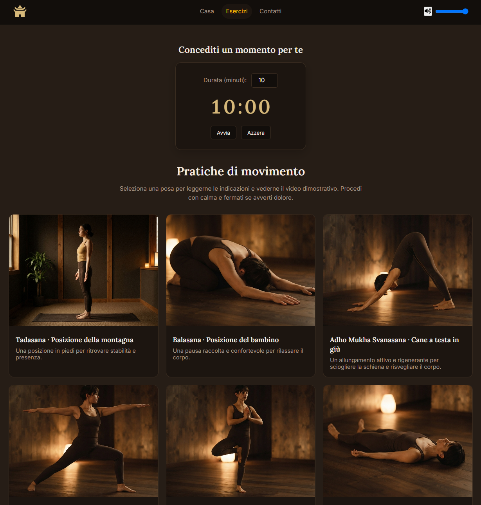
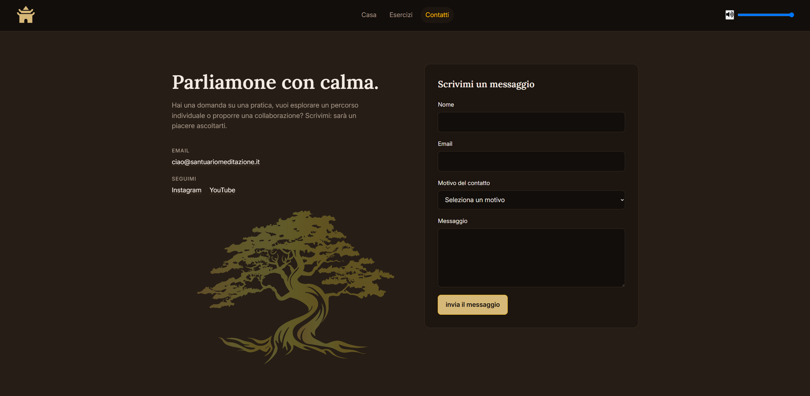

<div align="center">
  <h1>🌿 Santuario</h1>
  <p><strong>Lascia fuori il mondo. Ascolta, rallenta e ritrova il ritmo del respiro.</strong></p>
  <p>Uno spazio digitale dedicato alla meditazione, al respiro e al movimento consapevole.</p>
  <p><code>React</code> · <code>TypeScript</code> · <code>Vite</code> · <code>styled-components</code></p>
</div>

---

## Un luogo per ritrovare la calma

**Santuario** raccoglie in un'unica esperienza strumenti semplici per concedersi una pausa: suoni rilassanti, esercizi di respirazione e pratiche di movimento accompagnate da indicazioni e video.

## Anteprima

<table>
  <thead>
    <tr>
      <th align="center">Casa</th>
      <th align="center">Esercizi</th>
      <th align="center">Contatti</th>
    </tr>
  </thead>
  <tbody>
    <tr>
      <td align="center">
        <a href="src/assets/img/readme/casa.png">
          
        </a>
      </td>
      <td align="center">
        <a href="src/assets/img/readme/esercizi.png">
          
        </a>
      </td>
      <td align="center">
        <a href="src/assets/img/readme/contatti.png">
          
        </a>
      </td>
    </tr>
  </tbody>
</table>

## Cosa puoi fare

- **Rallentare il respiro** con un esercizio visivo guidato.
- **Creare la tua atmosfera** combinando i suoni del mixer e regolando il volume.
- **Prenderti un momento per te** con il timer e le pratiche di movimento, complete di istruzioni e video.
- **Trovare i riferimenti per contattarmi** dalla pagina dedicata.

> Il modulo Contatti è solo front-end: dopo l'invio mostra l'indirizzo email per scrivere direttamente.

## Tecnologie

React · TypeScript · Vite · styled-components · React Router · React Icons

## Avvio in locale

```bash
npm install
npm run dev
```

Per creare e visualizzare la build di produzione:

```bash
npm run build
npm run preview
```

La build viene generata in `dist/`. La configurazione include il percorso base per GitHub Pages del repository e crea `dist/404.html` per supportare le rotte dell'app.
